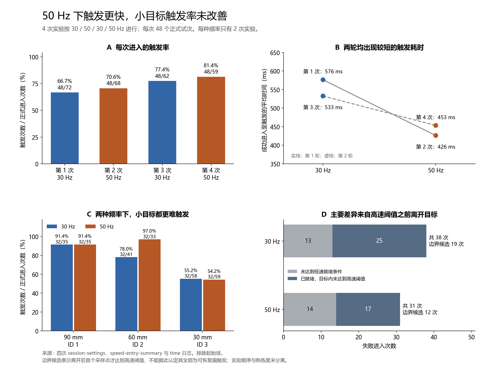

# 固定步长采样频率对 speed 触发的影响

本次四组记录中，50 Hz 与更短的触发耗时相关，整体单次进入触发率略高；改善主要体现在 60 mm 条件。30 mm 小目标在两种频率下的触发率接近，仍是主要困难。每种频率只有两次会话，以下结果是本次测试的描述性比较，不能将全部差异认定为帧率的因果效应。

## 1. 数据与统计口径

实际目录为 `30hz_50hz_analysis`。四次会话按 30、50、30、50 Hz 交替，各包含 48 个正式试次（ID 2、3、1 各 16 次），共 192 个。ID 是目标条件，不应当作受试者编号。三种直径根据遥测 boundsExtentX 的两倍确认，分别为 ID 1 = 90 mm、ID 2 = 60 mm、ID 3 = 30 mm；这些条件同时包含不同的目标环半径，因此尺寸间差异不能归因于直径一个因素。

所有记录为 speed 模式，低速阈值 0.067 m/s、高速阈值 0.375 m/s、timeScale=1，参数一致。按照 entryExperimentStarted=1 排除正式实验开始前的起始球记录，共排除 22 次进入，其中有 12 次起始球触发。保留 261 次正式进入，包含 192 次触发与 69 次离开未触发。

- **单次进入触发率**：正式触发次数 / 所有正式进入次数。一个试次可重入多次，分母不是完成试次数。
- **首次进入成功率**：每个试次的第一个正式 entry 是否成功 / 正式试次数。
- **成功进入至触发耗时**：只对最终成功 entry 计算 entryElapsed，包含等待低速就绪和随后达到高速的时间，不包含此前失败 entry 和目标间移动。
- **试次完成时间**：time.csv 的 usedTime，包含目标间移动、失败与重入等整个试次过程。

所有试次最终完成，且 errorTimes=0。这不等于每次接触都成功，也不能据此估计无意动作的误触率。

日志中的 30/50 Hz 是 FixedUpdate 采样频率；四次会话在正式区间内由 frame/realtime 估计的渲染帧率分别为 71.15, 71.08, 71.15, 71.10 FPS。此次比较主要改变了动作采样步长，而渲染帧率基本相同。

## 2. 四次会话分别比较

| 会话 | 采样 Hz | 正式进入次数 | 单次进入触发率 | 首次进入成功率 | 成功进入至触发均值 / s | 试次完成时间均值 / s |
| --- | --- | --- | --- | --- | --- | --- |
| 20261022-10-41-13 | 30 | 72 | 66.7% | 72.9% | 0.576 | 2.029 |
| 20261022-10-46-41 | 50 | 68 | 70.6% | 81.2% | 0.426 | 1.690 |
| 20261022-10-48-38 | 30 | 62 | 77.4% | 83.3% | 0.533 | 1.607 |
| 20261022-10-50-32 | 50 | 59 | 81.4% | 83.3% | 0.453 | 1.412 |

相邻会话作为两轮描述性比较：第一轮 50 Hz 比 30 Hz 的成功 entry 平均耗时短 150 ms，单次进入触发率高 3.9 个百分点；第二轮短 79 ms，高 3.9 个百分点。首次进入成功率在第一轮改善 8.3 个百分点，第二轮两者相同。两轮都支持“触发耗时较短”的方向，但触发可靠性改善幅度较小。

## 3. 合并后的频率差异

| 采样 Hz | 正式试次 | 正式进入次数 | 失败进入次数 | 单次进入触发率 | 首次进入成功率 | 成功进入耗时均值 / s | 成功进入耗时中位数 / s | 试次完成时间均值 / s |
| --- | --- | --- | --- | --- | --- | --- | --- | --- |
| 30 | 96 | 134 | 38 | 71.6% | 78.1% | 0.555 | 0.533 | 1.818 |
| 50 | 96 | 127 | 31 | 75.6% | 82.3% | 0.440 | 0.420 | 1.551 |

50 Hz 的成功进入平均触发耗时短 **115 ms（20.7%）**，中位数从 533 ms 降至 420 ms。平均试次完成时间从 1.818 s 降至 1.551 s，短 **267 ms（14.7%）**。

单次进入触发率从 96/134 = 71.6% 升至 96/127 = 75.6%，提高 **3.95 个百分点**。首次进入成功率从 75/96 = 78.1% 升至 79/96 = 82.3%，提高 4.17 个百分点。需要重试的试次从 21 次降至 17 次；失败 entry 从 38 次降至 31 次。

低速就绪时间均值从 159 ms 缩短到 133 ms；就绪后至触发时间从 396 ms 缩短到 306 ms。115 ms 差异中的大部分出现在“已低速就绪到达到高速”阶段。这是行为与判定共同形成的耗时，不能直接解释为系统处理延迟降低 115 ms。

## 4. 按目标条件拆分

每个频率、每个目标条件都有 32 个正式完成试次。

| 目标直径 / mm | 30 Hz 进入数 | 50 Hz 进入数 | 30 Hz 触发率 | 50 Hz 触发率 | 30 Hz 成功进入耗时 / ms | 50 Hz 成功进入耗时 / ms |
| --- | --- | --- | --- | --- | --- | --- |
| 90 | 35 | 35 | 91.4% | 91.4% | 458 | 323 |
| 60 | 41 | 33 | 78.0% | 97.0% | 526 | 434 |
| 30 | 58 | 59 | 55.2% | 54.2% | 679 | 562 |

**60 mm 条件的改善最明显**：单次进入触发率提高 18.9 个百分点，失败 entry 从 9 次降到 1 次。90 mm 条件均为 91.4%，可靠性相同，但 50 Hz 耗时更短。

**30 mm 条件没有可靠性改善**：触发率 55.2% 对 54.2%，失败 entry 为 26 次对 27 次，首次进入成功率为 68.8% 对 59.4%。50 Hz 的成功 entry 耗时仍短约 117 ms，但这不能等同于更容易一次成功。小目标仍需要进一步优化。

## 5. 失败发生在哪里

源码的顺序为：进入接触区域后，先在速度 ≤ 0.067 m/s 时置为就绪，随后仅在允许触发且速度 ≥ 0.375 m/s 时触发。接触判断为指尖或食指远端关节任意一个位于 collider 的轴对齐 bounds 内，并非只检查指尖是否位于球面内。

| 采样 Hz | 未低速就绪便离开 | 已就绪，内侧未达到高速便离开 | 其中：离开帧高速候选 | 候选 / 全部进入 |
| --- | --- | --- | --- | --- |
| 30 | 13 | 25 | 19 | 14.2% |
| 50 | 14 | 17 | 12 | 9.4% |

50 Hz 下未低速就绪便离开的次数没有减少（13 对 14），主要减少的是已就绪后、目标内没有达到高速阈值的失败（25 对 17）。未发现目标内已满足高速且就绪却仍未触发的正式 entry。

“离开帧高速候选”是已就绪、内侧最后一个速度低于高速阈值，但第一次离开采样速度已达到阈值的 entry。30 Hz 为 19 次，50 Hz 为 12 次，分别占全部进入的 14.2% 与 9.4%。它们是上一列失败的子集，不应重复相加。这与更密采样可能减少边界时机损失的解释一致，但两次端点观测不能证明跨界前的连续真实速度一定已达阈值。

其中，第一次 30 Hz 会话有 3 个候选的离开速度达到 15.3–17.5 m/s，应检查原始 tracking/pose 连续性。SDK 的有效标记和 trackingLossObserved=0 不能排除位置跳变。即使仅在候选机制分析中暂不计这 3 个异常点，候选仍是 16 对 12。主结果保留全部原始记录，未根据这个诊断阈值删除 trial 或 entry。

## 6. 速度估计与时间采样的解释

源码的速度公式为 `v = ||当前位置 - 前一采样位置|| / Time.fixedDeltaTime`，不是直接使用每帧位移。两种频率已经按各自时间间隔归一化。

- 30 Hz：2,117 个独立内侧采样点，速度中位数 0.0768 m/s，95 分位 0.6216 m/s。
- 50 Hz：2,717 个独立内侧采样点，速度中位数 0.0767 m/s，95 分位 0.6266 m/s。

这两个分布整体接近，没有证据表明 50 Hz 将速度普遍放大。逐帧数据有时间与试次内相关性，上述分位数仅描述采样值，不作为独立样本推断。50 Hz 的 2,717 个内侧点中有 55 个零速度点，30 Hz 的 2,117 个点中没有零值；这可以由相邻 pose 重复等因素形成，现有日志不足以判定其原因。

采样间隔从 33.33 ms 缩短到 20 ms，减少 13.33 ms。作为几何尺度示例：以 0.375 m/s 匀速运动时，一个采样间隔内的位移分别为 12.5 mm 和 7.5 mm。更短步长有机会捕获阈值与边界之间的时刻，但本次观察到约 115 ms 的完整 entry 耗时差异明显大于 13.33 ms，不能只用一次采样等待来解释。

## 7. 实验限制与下一步

两种频率的第二次会话都出现明显的可靠性改善：30 Hz 从 66.7% 到 77.4%，50 Hz 从 70.6% 到 81.4%，均约 10.8 个百分点，大于合并频率差异的 3.95 个百分点。这提示顺序、熟练度或其他会话差异影响较大。50 Hz 每次都紧跟在 30 Hz 后面，尚未对顺序做平衡；记录中也缺少可用于估计跨受试者效应的受试者标识。

因此，本报告不把 261 个 entry 或数千帧当作独立受试者来做显著性检验，也不据此宣称普遍的显著帧率效应。

本次调试可优先沿用 50 Hz，并保留 30 Hz 作为对照。若目标是修复 30 mm 小目标问题，应优先复查边界处的轨迹、就绪状态和 pose 跳变。对跨采样区间的接触与阈值做离线重放后，再评估连续碰撞/区间内判定方案及其误触代价。现有数据不足以给出应下调多少速度阈值的结论。

下一轮可采用跨会话或跨受试者平衡顺序的 ABBA/BAAB，充分练习后再测，保留每种目标条件的首次进入成功率、成功 entry 耗时、完整试次耗时和边界候选。正式统计应按受试者和会话处理重复测量。

## 8. 数据核验与可复现文件

发现四个 time.csv 均为表头 71 列、数据行 77 列。写入器追加了中心点与 16 个目标坐标，旧表头只列出 15 组坐标。前 26 个行为字段实际对齐，若直接 `pandas.read_csv`，可能自动推断多列索引，导致列值整体错读。本分析使用 csv.reader 按前 26 列解析，未修改原文件。

完成以下交叉核对：每个 trial 的 inTargetTimes 与正式 entry 数完全一致；每个成功 trial 对应且仅对应一次 trigger；insideSampleCount 与按 entry 和 motionSampleSequence 去重的 sample 数完全一致；usedTime 与 settings 相邻事件时间差的最大误差小于 0.008 ms。所有正式 entry 均无设置变更、采样率混合或已记录的追踪丢失。

分析仅将独立 motion sample 用于速度分布，未将重复 check 行当作独立采样。原文件的路径、字节数及 SHA-256 记录于 [audit.json](audit.json)。

- [按会话汇总](session_summary.csv)
- [按频率汇总](sampling_rate_summary.csv)
- [按目标条件汇总](target_size_summary.csv)
- [正式试次明细](formal_trials.csv)
- [正式进入明细](formal_entries.csv)
- [边界候选明细](boundary_candidates.csv)
- [可复现分析脚本](../../analysis/analyze_30hz_50hz.py)

原始证据：

- 20261022-10-41-13：[session-settings](../20261022-10-41-13/20261022-10-41-13-session-settings.csv)、[speed-entry-summary](../20261022-10-41-13/20261022-10-41-13-speed-entry-summary.csv)、[speed-boundary-debug](../20261022-10-41-13/20261022-10-41-13-speed-boundary-debug.csv)、[time](../20261022-10-41-13/20261022-10-41-13-time.csv)、[trajectory](../20261022-10-41-13/20261022-10-41-13-trajectory.csv)
- 20261022-10-46-41：[session-settings](../20261022-10-46-41/20261022-10-46-41-session-settings.csv)、[speed-entry-summary](../20261022-10-46-41/20261022-10-46-41-speed-entry-summary.csv)、[speed-boundary-debug](../20261022-10-46-41/20261022-10-46-41-speed-boundary-debug.csv)、[time](../20261022-10-46-41/20261022-10-46-41-time.csv)、[trajectory](../20261022-10-46-41/20261022-10-46-41-trajectory.csv)
- 20261022-10-48-38：[session-settings](../20261022-10-48-38/20261022-10-48-38-session-settings.csv)、[speed-entry-summary](../20261022-10-48-38/20261022-10-48-38-speed-entry-summary.csv)、[speed-boundary-debug](../20261022-10-48-38/20261022-10-48-38-speed-boundary-debug.csv)、[time](../20261022-10-48-38/20261022-10-48-38-time.csv)、[trajectory](../20261022-10-48-38/20261022-10-48-38-trajectory.csv)
- 20261022-10-50-32：[session-settings](../20261022-10-50-32/20261022-10-50-32-session-settings.csv)、[speed-entry-summary](../20261022-10-50-32/20261022-10-50-32-speed-entry-summary.csv)、[speed-boundary-debug](../20261022-10-50-32/20261022-10-50-32-speed-boundary-debug.csv)、[time](../20261022-10-50-32/20261022-10-50-32-time.csv)、[trajectory](../20261022-10-50-32/20261022-10-50-32-trajectory.csv)

算法对照：[AcceStudy3.cs](D:/HLStudy4_22/Assets/Scripts/Study3/AcceStudy3.cs)、[S2AccMode.cs](D:/HLStudy4_22/Assets/Scripts/Study3/S2AccMode.cs)、[SpeedStudyTelemetry.cs](D:/HLStudy4_22/Assets/Scripts/Study3/SpeedStudyTelemetry.cs)、[LogWriter3.cs](D:/HLStudy4_22/Assets/Scripts/Study3/LogWriter3.cs)。源码用于解释现有字段，实际实验条件以会话日志为准。
